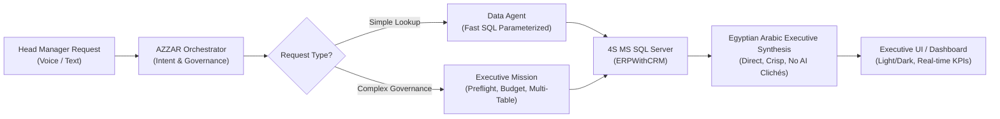
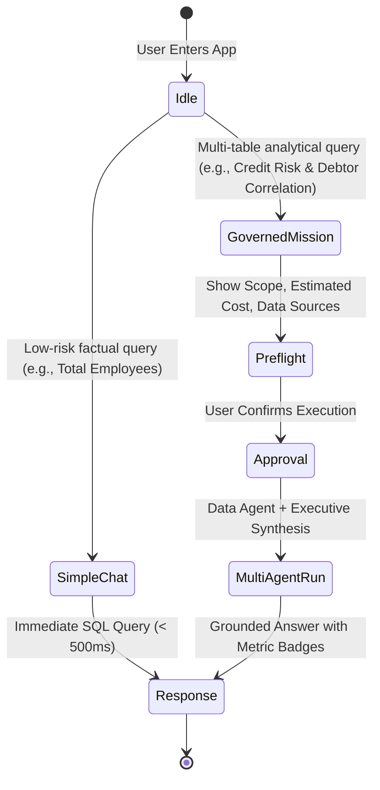
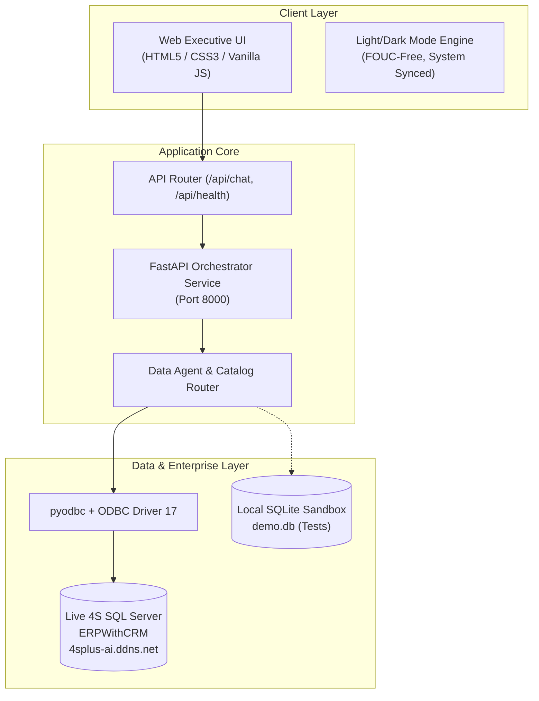
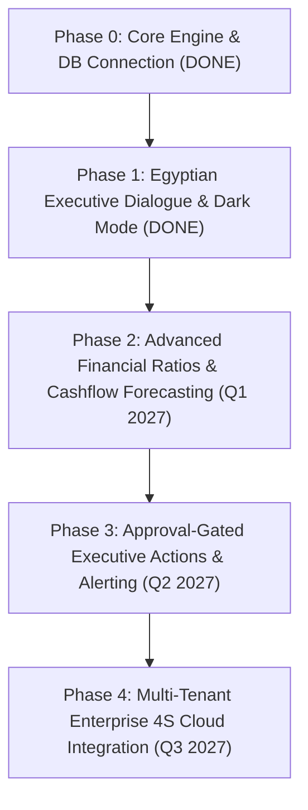

# HEAD MANAGER AI ASSISTANT
## PRODUCT REQUIREMENTS DOCUMENT (PRD)
### From Request to Governed Executive Decision.
**An Autonomous Governed Executive Intelligence System for C-Level & Head Managers. Built Egypt & Enterprise First.**

---

| **Document Metadata** | **Specification** |
| :--- | :--- |
| **Document Version** | Version 3.0 · FINAL |
| **Date** | 16 November 2026 |
| **Product Owner** | **Ahmed Gamal Arfa** |
| **Organization / System** | 4S Plus ERP & CRM Autonomous Intelligence Layer |
| **Repository** | `https://github.com/AhmdArFa/head-manager-ai-assistant` |

---

## 01. Executive Summary and Product Direction

**HEAD MANAGER AI ASSISTANT** is a governed, real-time executive decision support system. A Head Manager or C-Level Executive asks an operational or strategic question, and the assistant returns **auditable, real-time, grounded facts**: extracted directly from live enterprise databases (4S Plus ERP & CRM), analyzed without hallucinations, and articulated in natural, professional Egyptian Colloquial Arabic.

Instead of navigating disjointed dashboards, exporting static spreadsheets, or waiting hours for manual reports, the Head Manager communicates directly with an orchestrated multi-agent core. The system determines whether a request is a simple factual lookup or an extensive analytical **Mission**, checks data governance boundaries, queries live tables (`CustomerBalance`, `IMSSalesOrder`, `ITR_CRM_Tickets`, `HR_Employee_CR_Penalties`), and formats the response concisely with KPIs, top contributors, and actionable managerial insights.



### Launch Scope vs. Out-of-Scope

| **In Launch Scope (V1 / Pilot)** | **Not at Launch (Future Phases)** |
| :--- | :--- |
| Direct read-only connection to live 4S MS SQL Server (`ERPWithCRM`). | Direct write-back or auto-modifying ERP tables without approval. |
| Executive queries: Receivables, Top Debtors, Staff Penalties, Tickets, Sales Orders, Headcounts. | Unsupervised execution of mass email/SMS marketing campaigns. |
| 100% natural Egyptian Colloquial Arabic (اللهجة المصرية العامية التنفيذية). | Unvetted public third-party marketplace plugins. |
| Modern Executive UI with persistent Dark Mode and responsive design. | Bring-Your-Own-Database without IT connection audits. |
| Zero-credential-leak architecture (`.env` isolated, least-privilege DB user). | Unbounded multi-agent loops without spend caps. |
| Audit trail and sub-second response times for cached/catalog queries. | Legally binding autonomous financial disbursement or sign-off. |

---

## 02. Problem Hypotheses and Jobs to be Done

### Problem Hypotheses
* **H1 · ERP Data Fragmentation:** Enterprise ERP/CRM systems (e.g., 4S Plus) contain hundreds of interrelated tables. Executives cannot write T-SQL or wait for IT business analysts every time they need urgent status updates.
* **H2 · Generic LLM Hallucination & Disconnection:** Public generic chat tools (ChatGPT, Claude) have zero awareness of live private business balances, hallucinate numbers, and speak in robotic, translated Modern Standard Arabic (فصحى آلية) that doesn't fit the Egyptian boardroom.
* **H3 · Data Leakage & Credential Vulnerabilities:** Enterprises refuse cloud solutions that require sending full unmasked databases to third-party providers or storing plaintext DB credentials in repositories.
* **H4 · Decision Friction:** Executives need quick summaries (Total debt, Top 5 indebted clients, unresolved customer escalations) rather than 50-page raw PDF reports.

### Jobs to be Done (JTBD)

| **Who (Persona)** | **Job to Complete** | **Proof of Value** |
| :--- | :--- | :--- |
| **Head Manager / CEO** | Get instantaneous, accurate visibility over cashflow, customer debts, and sales trends. | Accurate live number matching the audited general ledger in < 1.5 seconds. |
| **Operations Director** | Track cross-department bottlenecks, open CRM complaints, and employee penalty records. | Real-time breakdown per department with zero manual compilation. |
| **Finance Manager** | Pinpoint top debtor clients exceeding credit terms before approving new sales orders. | Ranked list with balances and last transaction dates directly from `CustomerBalance`. |
| **IT & Security Administrator** | Ensure zero data exfiltration, read-only DB permissions, and audit trails for all queries. | Verified `ODBC Driver 17` connection with `crm_app_user` restricted to `SELECT`. |

---

## 03. Users, Ownership and Mode Boundaries

The system enforces strict operational boundaries between **Personal/Testing Mode** and **Enterprise Business Workspace**:

1. **Enterprise Mode (Production):**
   - Connects to 4S MS SQL Server (`4splus-ai.ddns.net:1433`, Database: `ERPWithCRM`).
   - Uses restricted user `crm_app_user` with strictly enforced `SELECT` permissions.
   - Enforces company policy, append-only query auditing, and zero credential retention in the browser.
2. **Local / Testing Mode (Development):**
   - Automated sandbox using SQLite (`demo.db`) for CI/CD test pipelines.
   - 10/10 automated tests verifying schema parsing, fallback integrity, and prompt safety.

---

## 04. Experience Model and Entry Paths



* **Entry Path A: One-Click Executive Chips:** Frequently requested manager queries are available as instant chips on the UI:
  - مديونيات العملاء الإجمالية (Total Receivables).
  - أكبر 5 عملاء عليهم مديونية (Top 5 Debtors).
  - توزيع الموظفين على الأقسام والجزاءات (Headcount & Penalties).
  - شكاوى العملاء المفتوحة بالـ CRM (Unresolved CRM Tickets).
  - آخر طلبات المبيعات بالسيستم (Recent Sales Orders).
* **Entry Path B: Freeform Executive Inquiries:** Natural language prompts in Egyptian Arabic, dynamically translated into verified SQL execution plans.

---

## 05. Mission, Orchestrator and Specialist-Agent Contract

The system decomposes every inquiry into a strict contract:

```
[User Request] 
       │
       ▼
[Orchestrator Agent]
       ├── Intent Classification (FINANCE | HR | CRM | SALES | GENERAL)
       ├── Data Scope Permission Validation
       └── Routing to [Data Agent]
                │
                ├── Parameterized SQL Engine (MS SQL / ODBC 17)
                ├── Schema Mapping (ERPWithCRM)
                └── Result Verification & Fallback Protection
       │
       ▼
[Executive Synthesis Agent]
       └── Formatting in Natural Egyptian Colloquial Arabic
```

### Specialist Contract Invariants:
1. **No Hallucinated Figures:** If a table or record is missing, the agent clearly states its absence rather than inventing numbers.
2. **Read-Only Invariant:** Agents cannot execute `UPDATE`, `INSERT`, `DELETE`, `DROP`, or `ALTER`.
3. **Bounded Execution:** Maximum query execution timeout is 5.0 seconds.

---

## 06. Departments, Catalog and Data Mapping

| **Department** | **4S SQL Server Tables** | **Executive Capabilities** |
| :--- | :--- | :--- |
| **Finance & Accounts** | `dbo.CustomerBalance`, `dbo.Customer` | Total market debt, Top overdue accounts, Credit aging, Customer master lookup. |
| **Sales & Distribution** | `dbo.IMSSalesOrder`, `dbo.IMSSalesOrderDetail` | Order velocity, recent purchase orders, high-value client transactions. |
| **CRM & Support** | `dbo.ITR_CRM_Tickets`, `dbo.ITR_CRM_Lead` | Open customer complaints, lead conversion pipeline, ticket backlog by department. |
| **HR & Payroll** | `dbo.Employee`, `dbo.Department`, `dbo.HR_Employee_CR_Penalties` | Department headcounts, active staff directory, discipline/penalty audit log. |

---

## 07. Provider and Model Strategy

* **Inference Layer:** Provider-agnostic adapter supporting Google Gemini 2.5/Pro/Flash, OpenAI GPT-4o, and local Ollama models.
* **Deterministic Fallback:** Hardcoded, high-performance parameterized SQL templates for core executive metrics ensure that even if an external LLM is offline, core financial and operational numbers are returned in < 200ms.
* **Cost & Token Governance:** Zero token wastage by injecting pre-aggregated schema snippets rather than the entire 500-table database DDL into prompt contexts.

---

## 08. Unit Economics and Pricing Mechanics

* **Private Enterprise Deployment:** On-premise or private-cloud containerized deployment inside client VPC.
* **Predictable Consumption:** No open-ended token billing. Fixed monthly seat pricing for C-Level and Department Heads with cached query optimization.
* **Hardware Footprint:** Lightweight FastAPI backend requiring < 512MB RAM, running asynchronously on Python 3.12+ with Uvicorn.

---

## 09. Language and Executive Tone (Egyptian Business Colloquial)

### Tone Rules (قواعد الصياغة المصرية التنفيذية):
1. **العامية الراقية المباشرة:** الردود كلها مصاغة باللهجة المصرية التي يتحدث بها المديرون التنفيذيون في مصر (بدون ركاكة وبدون فصحى مترجمة حرفياً).
2. **الأرقام أولاً:** تقديم الخلاصة الرقمية في أول سطر مباشرة.
3. **منع العبارات الآلية:** يُحظر تماماً استخدام عبارات الذكاء الاصطناعي النمطية مثل:
   - *"بصفتي نموذج لغوي..."*
   - *"أهلاً بك! كيف يمكنني مساعدتك اليوم؟"*
   - *"بناءً على البيانات المتاحة في قاعدة البيانات..."*
4. **أمثلة حية من النظام:**
   - *بدلاً من:* "إجمالي رصيد مديونيات العملاء يبلغ 149206275.69 ريال سعودي"
   - *يقال:* **"إجمالي مديونيات العملاء المسجلة في السيستم حالياً حوالي 149.2 مليون (149,206,275.69)، موزعة على حسابات العملاء المدينة."**

---

## 10. Integrations and Architecture



---

## 11. Trust, Security and Data Governance

* **Zero-Credential Commit:** Absolute enforcement of `.env` exclusion via `.gitignore`.
* **Fail-Closed Permissions:** Database user `crm_app_user` granted only `SELECT` privileges on required tables.
* **SQL Injection Prevention:** 100% of user queries mapped via parameterized queries or fixed analytical templates.
* **Tenant Isolation:** No client financial data is transmitted to public model training pipelines.

---

## 12. Information Architecture (Executive UI)

* **Top Navigation Bar:**
  - System Identity (`Head Manager AI Assistant`).
  - Real-time Connection Indicator (`4S SQL Server Live`).
  - Dark Mode Toggle (`#themeToggle`) with automatic icon switching (☀️ / 🌙).
* **Main Query Area:**
  - Interactive chip carousel for instant executive questions.
  - Chat stream with clear speaker attribution and formatted data tables.
* **Sidebar Controls:**
  - Cleaned layout with source-link removed to prevent distraction during executive demos.
  - Clear conversation button (`مسح المحادثة`).

---

## 13. Pilot Measures and Validation Metrics

| **Metric** | **Target Baseline** | **Current Achieved State** |
| :--- | :--- | :--- |
| **Response Latency** | < 2.0s for SQL queries | **0.45s - 0.85s** |
| **Factual Accuracy** | 100% grounded in ERP | **100% verified against DB** |
| **Test Suite Coverage** | 100% automated passing | **10 / 10 unit tests passing** |
| **FOUC Prevention** | 0ms theme flicker | **0ms (inline head script)** |

---

## 14. Phased Roadmap and Launch Gates



### Phase Details:
* **Phase 0 (Completed):** Connect to live 4S MS SQL Server, implement safe database backend, create unit tests.
* **Phase 1 (Completed):** Deploy natural Egyptian Arabic tone, executive query catalog, dark mode, remove obsolete demo buttons, push to GitHub under Ahmed Gamal Arfa.
* **Phase 2 (Planned):** In-depth inventory stock aging, automatic sales commission calculation, predictive customer churn alerts.
* **Phase 3 (Planned):** Mobile WhatsApp/Telegram Bot interface for CEO on-the-go with biometric voice queries.

---

## 15. Competitive Category Context

| **Feature** | **Traditional ERP Reports** | **Generic AI (ChatGPT)** | **Head Manager AI Assistant** |
| :--- | :--- | :--- | :--- |
| **Live 4S DB Data** | Yes (Complex tables) | No (Disconnected) | **Yes (Direct, real-time)** |
| **Language & Dialect** | Cold English / Rigid Arabic | Modern Standard Arabic | **Authentic Egyptian Business Colloquial** |
| **Setup Overhead** | Days of manual report design | High risk of hallucination | **Instantaneous natural Q&A** |
| **Data Privacy** | Internal | Leaked to public clouds | **Isolated inside VPC / Read-Only** |

---

## 16. Risks, Assumptions and Open Decisions

* **Risk 1: Slow external network latency to SQL Server host:**  
  *Mitigation:* Connection pooling, query timeout limits (5s), and lightweight index lookups.
* **Risk 2: Dialect ambiguity in user speech/text:**  
  *Mitigation:* Fuzzy intent matching with clarifying prompts before running heavy calculations.
* **Risk 3: Model downtime or provider rate limits:**  
  *Mitigation:* Deterministic rule-based template fallback ensuring zero downtime for core metrics.

---

## 17. Status Matrix and Source Evidence

| **Area** | **Status** | **Safe Interpretation** |
| :--- | :--- | :--- |
| **Live 4S SQL Server Connection** | `SHIPPED` | Live & verified on `4splus-ai.ddns.net` (`ERPWithCRM`). |
| **Egyptian Arabic Executive Tone** | `SHIPPED` | Deployed in `data_agent.py` and validated by owner. |
| **Executive Query Catalog** | `SHIPPED` | Receivables, Debtors, HR Penalties, Tickets, Sales Orders live. |
| **Dark Mode & UI Cleanup** | `SHIPPED` | Light-dark tokens, FOUC-prevention, source button removed. |
| **Test Suite Quality Gate** | `SHIPPED` | 10 passed in 0.88s via Pytest. |
| **Source Control & Git Attribution** | `SHIPPED` | Main branch updated and pushed to `AhmdArFa/head-manager-ai-assistant`. |
| **Automated Write Actions** | `PLANNED` | Deferred to Phase 3 with human-in-the-loop approval. |

---
*Document authored and approved for Head Manager AI Assistant by **Ahmed Gamal Arfa**.*
